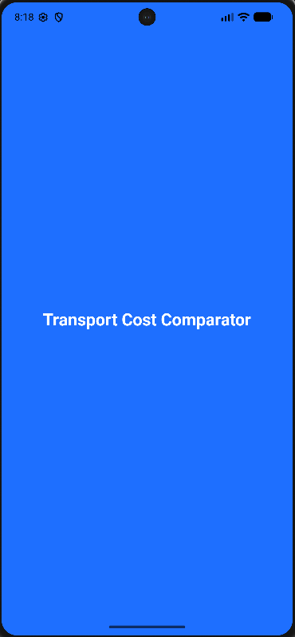
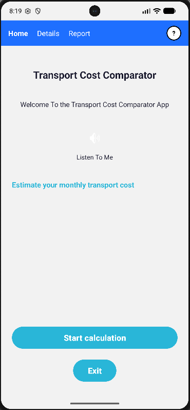
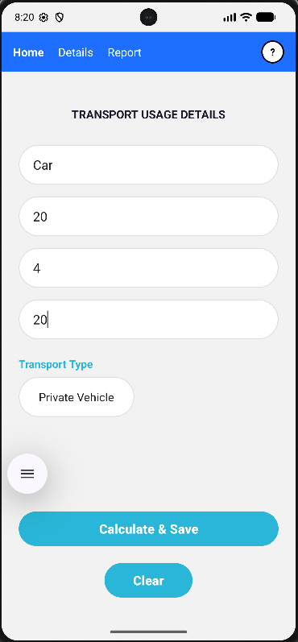
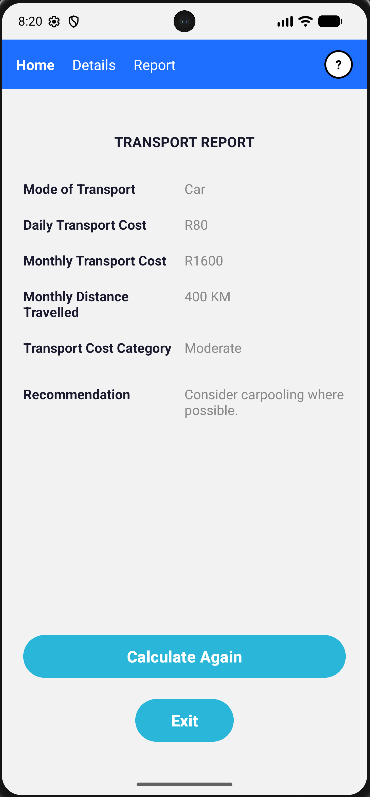

# Transport Cost Comparator

An Android app that helps South African commuters estimate and compare their monthly transport costs across different modes of transport.

## Features

- **Cost Calculation** — enter distance per day, cost per kilometre, and travel days per month to calculate daily and monthly transport costs.
- **Transport Type Selection** — choose from Private Vehicle, Taxi, Bus, Train, or Motorcycle.
- **Cost Category & Recommendation** — automatically categorises monthly spending (Low / Moderate / High / Very High / Excessive) and suggests cost-saving actions.
- **SQLite Storage** — saves each calculation to a local database for the report screen.
- **Text-to-Speech** — listen to the app welcome message on the home screen.
- **Splash Screen** — branded launch screen.
- **Fragment Navigation** — Home, Details (input), Report (results), and Help screens via a top navigation bar.

## Tech Stack

- Java 11, Android SDK 36
- SQLite via `SQLiteOpenHelper`
- AndroidX AppCompat, Material 3
- Text-to-Speech API
- Gradle Kotlin DSL

## Project Structure

```
app/src/main/java/com/example/transportcostcomparator/
├── SplashActivity.java      — launch screen (2 s delay)
├── MainActivity.java        — hosts fragments + top nav bar
├── HomeFragment.java         — welcome screen with TTS
├── DetailsFragment.java      — input form + calculate & save
├── ReportFragment.java       — displays latest calculation
├── HelpFragment.java         — troubleshooting tips
├── Transport.java            — data model (POJO)
├── TransportCalculator.java  — daily/monthly cost logic
├── TransportDbHelper.java    — SQLite CRUD
├── TransportData.java        — static data holder
└── Recommendation.java       — cost category + advice
```

## Screenshots

<table>
  <tr>
    <td></td>
    <td></td>
    <td></td>
    <td></td>
  </tr>
</table>

## Build & Run

1. Open in Android Studio (Ladybug or later).
2. Sync Gradle.
3. Run on an emulator or device (min SDK 24).

## Author

Lethabo Mashia — BSc IT (Software Engineering), Eduvos
